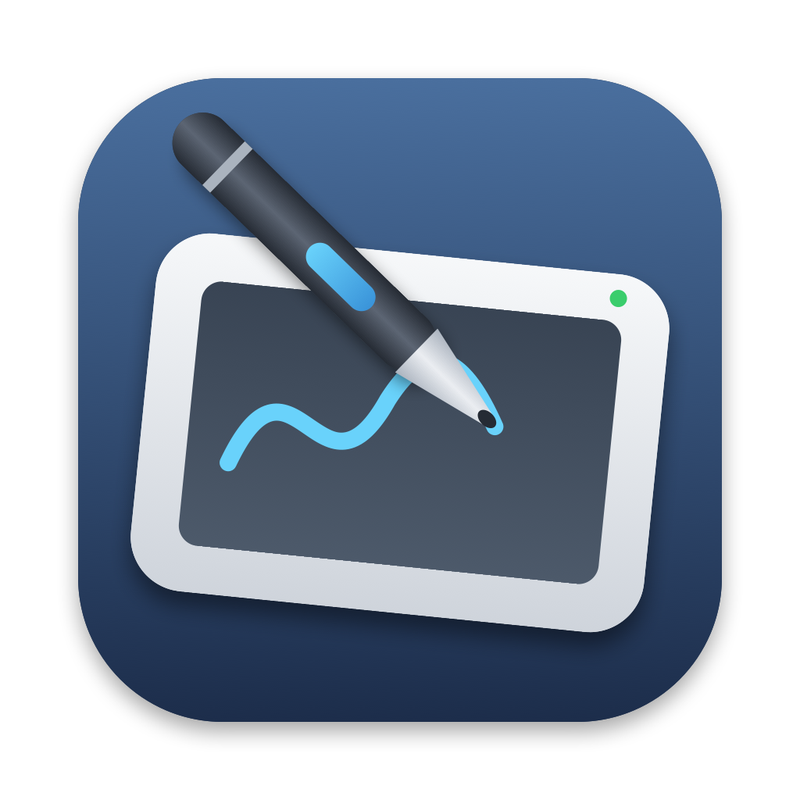
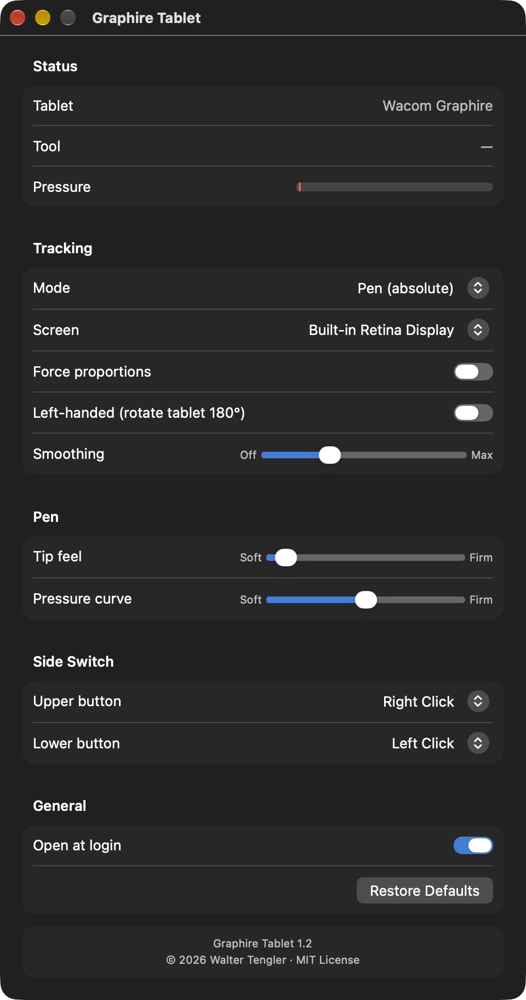

<p align="center"></p>

# Graphire Tablet

A small native **Apple Silicon** driver and menu-bar settings app for the original **Wacom Graphire** tablet (model **ET-0405-U**, USB `056A:0010`).

Wacom's last driver for this tablet (6.1.6) is Intel-only. On Apple Silicon Macs it runs only through Rosetta 2, which Apple is phasing out after macOS 27, and its settings panel no longer appears in System Settings. This app replaces the whole driver with about 800 lines of Swift. It runs natively and has no kernel extension.

## Features

- **Pen mode (absolute):** map the tablet to the built-in display, any external display, or all displays. Optional *force proportions*.
- **Mouse mode (relative):** with adjustable speed.
- **Pressure** goes to drawing apps as native macOS tablet events. **Eraser** is recognised.
- **Tip feel:** set how hard you press before a click, with a live pressure meter.
- **Pressure curve:** soft, linear or firm.
- **Side switch:** assign the upper and lower halves to right click, double click, middle click, left click, or disabled.
- **Left-handed mode** (tablet rotated 180°) and **jitter smoothing**.
- **Graphire mouse (puck):** buttons and scroll wheel.
- Menu-bar icon, **open at login**, and recovers after sleep and when the tablet is unplugged and plugged back in.

<p align="center"></p>

## Requirements

- Apple Silicon Mac, macOS 13 or later (developed on macOS 27).
- Wacom Graphire ET-0405-U (USB). Other Graphire models use different USB IDs and are not supported yet.
- **The Wacom driver must not be running**, because only one program can control the tablet at a time. See [Disabling the Wacom driver](#disabling-the-wacom-driver).

## Install

### From a release

1. Download `Graphire-Tablet.zip` from [Releases](../../releases), unzip it, and move **Graphire Tablet.app** to `/Applications`.
2. The app is signed but **not notarized**, so macOS will block it on first launch. Remove the quarantine flag:
   ```bash
   xattr -dr com.apple.quarantine "/Applications/Graphire Tablet.app"
   ```
3. Open the app. When asked, allow it in **System Settings → Privacy & Security → Accessibility**. It needs this to move the pointer.

### From source

Requires Xcode or the Command Line Tools.

```bash
git clone https://github.com/portwally/graphire-tablet.git
cd graphire-tablet
./build.sh install     # builds, copies to /Applications and launches
```

`./build.sh` alone only builds into `build/`. The script signs with your first *Apple Development* identity if you have one, otherwise ad-hoc. With a stable identity, the Accessibility permission survives rebuilds.

## Usage

Click the **pencil icon** in the menu bar:

- **Settings…:** mode, screen, proportions, smoothing, tip feel, pressure curve, side switch, open at login.
- **Open at Login:** on by default after first launch.
- The menu warns you if the Wacom driver is still running.
- Opening the app again (Finder, Spotlight or Launchpad) also opens Settings.

Hover the pen to move the pointer, and touch the tablet to click. Pressure is sent only while the tip is down.

## Disabling the Wacom driver

If you installed Wacom's driver (or the patched one from [wacom-driver-fix](https://github.com/thenickdude/wacom-driver-fix)), stop it without deleting anything:

```bash
launchctl bootout gui/$(id -u)/com.wacom.wacomtablet
launchctl disable gui/$(id -u)/com.wacom.wacomtablet
```

To go back to the Wacom driver, quit Graphire Tablet, turn off *Open at Login*, then:

```bash
launchctl enable gui/$(id -u)/com.wacom.wacomtablet
launchctl bootstrap gui/$(id -u) /Library/LaunchAgents/com.wacom.wacomtablet.plist
```

## How it works

- **IOKit HID:** the app opens the tablet exclusively, so macOS's generic mouse driver doesn't also move the pointer. It then sends feature report `2 = [0x02, 0x02]`, which switches the tablet from its power-on mouse mode to full tablet mode.
- **Input report 2** (8 bytes) carries proximity, the tool type (pen, eraser or mouse), X (0–10206), Y (0–7422), pressure (0–511) and buttons. The layout comes from the Linux kernel's `wacom_graphire_irq` and was checked on real hardware. See the comment at the top of [`Sources/TabletDriver.swift`](Sources/TabletDriver.swift).
- **Core Graphics events:** the app posts mouse events with the tablet-point subtype and pressure, plus tablet-proximity events, so drawing apps see a real pen.

| File | Purpose |
|---|---|
| `Sources/TabletDriver.swift` | USB HID access, report parsing, event posting |
| `Sources/Settings.swift` | Settings saved in UserDefaults |
| `Sources/SettingsView.swift` | SwiftUI settings window, login item |
| `Sources/Displays.swift` | Display lookup and screen rectangles |
| `Sources/App.swift` | Menu-bar app, permissions |
| `build.sh` | Build, sign, install |

The log is at `~/Library/Logs/GraphireTablet.log`.

## Status

Tested: pen tracking, tip click, side switch, screen mapping (built-in and external display).
Not yet tested: pressure in specific drawing apps, the eraser, the Graphire mouse. Issues and pull requests are welcome.

## Credits

- Report format and mode switch: the Linux kernel `hid-wacom` driver.
- [wacom-driver-fix](https://github.com/thenickdude/wacom-driver-fix), which kept the old Wacom drivers alive on modern macOS.

Wacom and Graphire are trademarks of Wacom Co., Ltd. This project is not affiliated with Wacom.

## License

[MIT](LICENSE)
